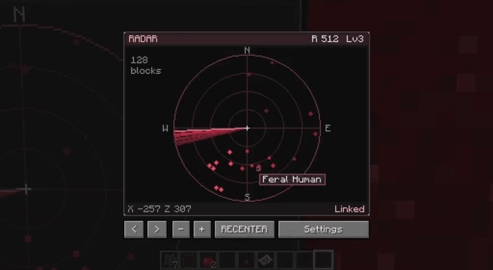

<h1 align="center">Scape and Run: Parasites Reconnaissance Addon</h1>

<p align="center">
  Radar, infection monitoring and radio networks for SRP.<br>
  Minecraft 1.12.2 · Forge 14.23.5.2847 · SRP 1.9.21
</p>

<p align="center">
  
</p>

<p align="center"><em>Prototype preview. Rewrite in progress.</em></p>

## Build

JDK 8 (`JAVA_HOME`) and JDK 21+ (`CHECKSTYLE_JAVA_HOME`).

```sh
./gradlew --no-daemon setupDecompWorkspace
./gradlew --no-daemon clean build
```

Output: `build/libs/srp-reconnaissance-0.1.0.jar`.

[CI](https://github.com/onitofu/srp-reconnaissance/actions/workflows/build.yml) · [Checkstyle](checkstyle.xml)
